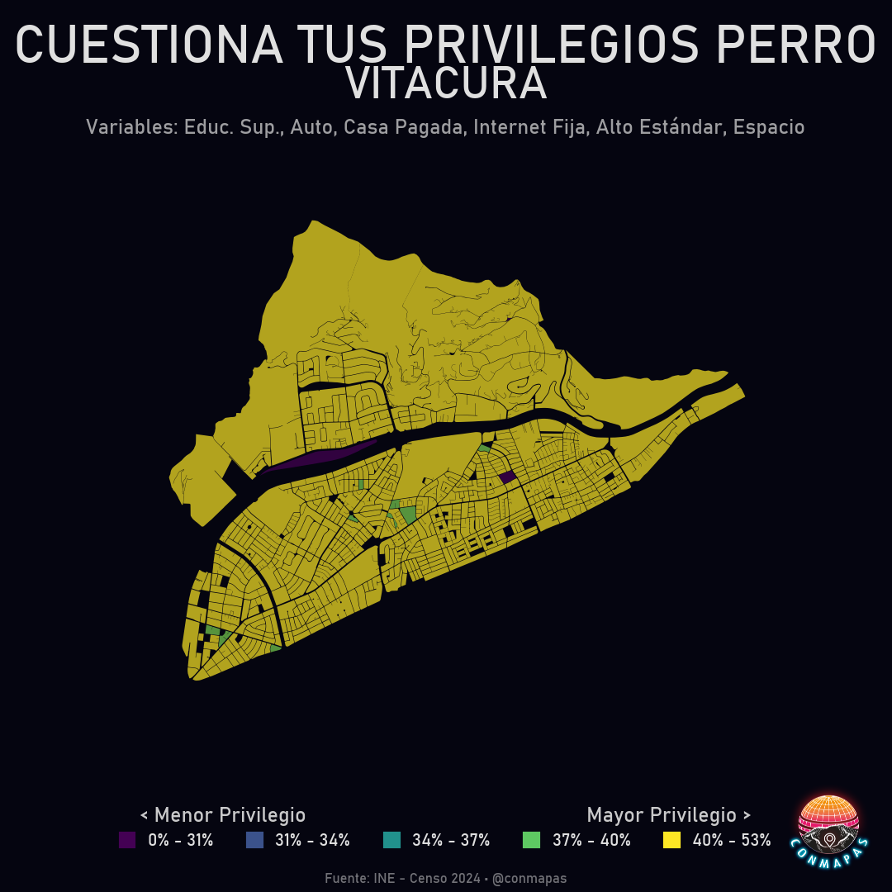
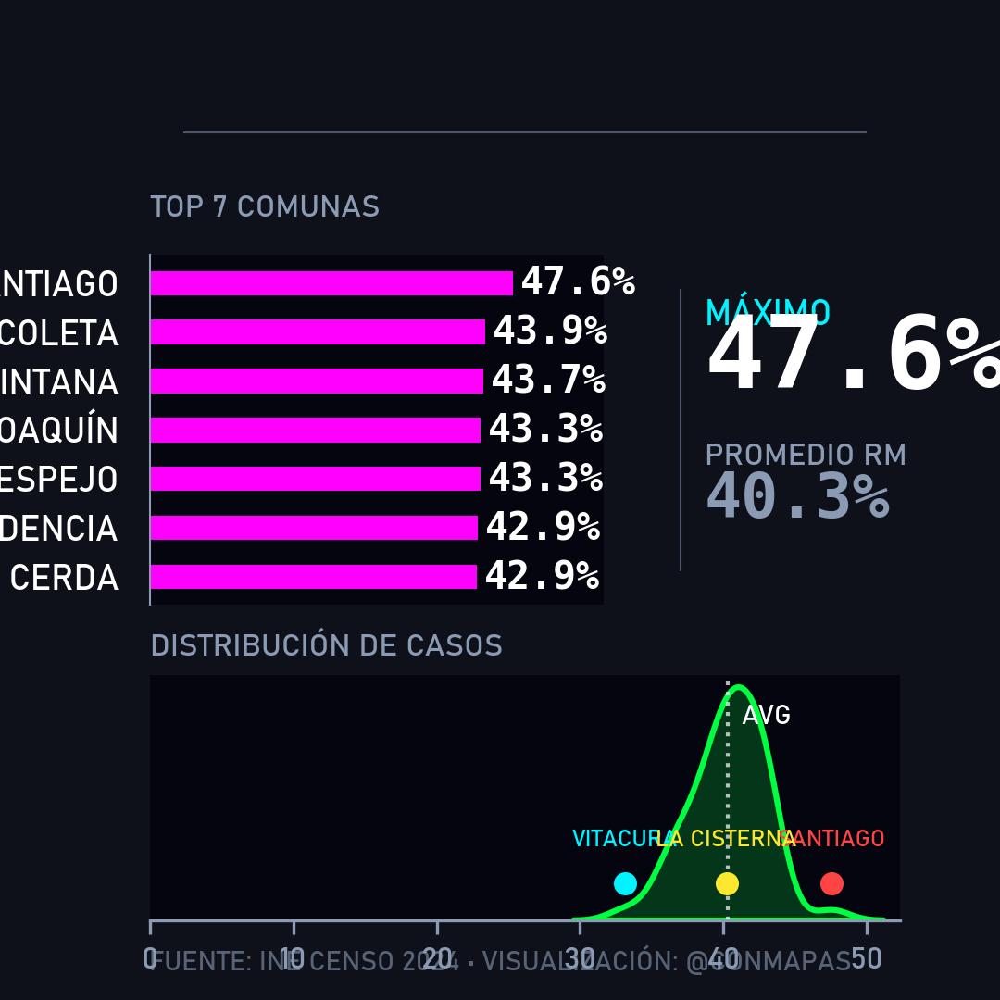

# 🗺️ Censo 2024 - Visualizaciones Territoriales

Herramientas para procesar y visualizar datos del Censo 2024 de Chile, con enfoque en la Región Metropolitana.

**Por [@conmapas](https://instagram.com/conmapas)**

[Ver resultados](#vista-previa) · [Reproducir mapas](#-uso) · [Metodología](#-metodología)

## Vista previa

Puedes explorar los resultados incluidos sin instalar Python ni descargar la cartografía completa.

| Mapa territorial | Panel de indicadores |
|---|---|
| [](mapas_finales_instagram/cuestiona_privilegios_MAX_GranSantiago_VITACURA.png) | [](mapas_finales_instagram/aun_sin_anillo_DASH_GranSantiago.png) |
| Cuestiona tus Privilegios | Aún Sin Anillo |

[Explorar todos los mapas, rankings y paneles →](mapas_finales_instagram/)

> Los nombres de los indicadores forman parte de la propuesta editorial del proyecto. Los índices compuestos son elaboraciones de este repositorio, no indicadores oficiales del INE.

---

## 📊 Indicadores Disponibles

| Indicador | Descripción | Variables |
|-----------|-------------|-----------|
| **Precariedad Habitacional** | Índice compuesto de hacinamiento, allegamiento, calidad de vivienda y saneamiento | 8 variables |
| **Vulnerabilidad Social** | Desempleo, analfabetismo, brecha digital, jefatura femenina | 4 variables |
| **Cuestiona tus Privilegios** | Educación superior, auto, casa pagada, internet fija, espacio | 6 variables |
| **Aún Sin Anillo 💍** | % de población adulta soltera (estado civil declarado) | Estado civil |
| **Dormitorio Compartido 🛏️** | % de viviendas con hacinamiento (>2.5 personas/dormitorio) | Hacinamiento |

---

## 🚀 Uso

### 1. Preparar el proyecto

Necesitas Git y Python con soporte para las bibliotecas geoespaciales utilizadas. Ejecuta los comandos desde la raíz del repositorio, preferentemente en un entorno virtual:

```bash
git clone https://github.com/geoidegeoidal/censo_2024.git
cd censo_2024
python -m pip install geopandas pandas numpy matplotlib seaborn mapclassify
```

Las versiones de las dependencias no están fijadas en este repositorio; la reproducción puede requerir ajustes según tu entorno.

### 2. Datos de Entrada
Descarga la cartografía del Censo 2024 desde el [INE](https://www.ine.gob.cl/) y coloca `Cartografia_censo2024_Pais.gpkg` en la raíz del proyecto. El procesamiento espera la capa `Manzanas_CPV24` y filtra las manzanas urbanas de la Región Metropolitana.

| Recurso | Disponibilidad |
|---|---|
| [Mapas PNG](mapas_finales_instagram/) | Incluidos: se pueden consultar directamente. |
| [Diccionario de variables](Diccionario_variables_geograficas_CPV24.xlsx) | Incluido como referencia de los datos. |
| `Cartografia_censo2024_Pais.gpkg` | Descarga externa; no está versionado. |
| `Manzanas_Indicadores.gpkg` | Se genera localmente; no está versionado. |

### 3. Procesamiento

**Cartografía original → indicadores por manzana → mapas y paneles.**

```bash
# Procesa datos crudos y genera Manzanas_Indicadores.gpkg
python process_census_data.py

# Genera mapas e infografías para Instagram
python generate_maps.py
```

### 4. Resultados
Los mapas se guardan en [`mapas_finales_instagram/`](mapas_finales_instagram/). Regenerarlos puede modificar los PNG incluidos; conserva una copia si necesitas comparar versiones:
- `*_MAX_*.png` - Mapa de la comuna destacada
- `*_DASH_*.png` - Dashboard con estadísticas
- `*_LOLLIPOP.png` - Ranking de comunas
- `*_ELEM_*.png` - Elementos individuales

---

## 📁 Estructura

```
censo_2024/
├── process_census_data.py    # ETL y cálculo de indicadores
├── generate_maps.py         # Visualización cyberpunk
├── Manzanas_Indicadores.gpkg # Datos procesados (generado)
└── mapas_finales_instagram/  # Output visual
```

---

## 🎨 Estilo Visual

- Paleta **Cyberpunk** con fondo oscuro (#050510)
- Colores neón (magenta, cyan, verde, amarillo)
- Clasificación **Fisher-Jenks** (5 clases)
- Optimizado para **Instagram** (1080x1080px)

---

## 📐 Metodología

### Índices Compuestos
1. Se calculan porcentajes por variable
2. Se normalizan con **Z-Score** (media=0, std=1)
3. Se promedian las dimensiones
4. Se escalan a **0-100** con Min-Max

### Indicadores Simples
- **Soltería**: `n_solteros / (suma todos los estados civiles) × 100`
- **Hacinamiento**: `n_viv_hacinadas / n_vp_ocupadas × 100`

---

## 📝 Licencia

Datos: [INE Chile](https://www.ine.gob.cl/) - Uso libre con atribución  
Código: MIT

---

## 🔗 Links

- Instagram: [@conmapas](https://instagram.com/conmapas)
- Datos: [Censo 2024 INE](https://www.ine.gob.cl/)
